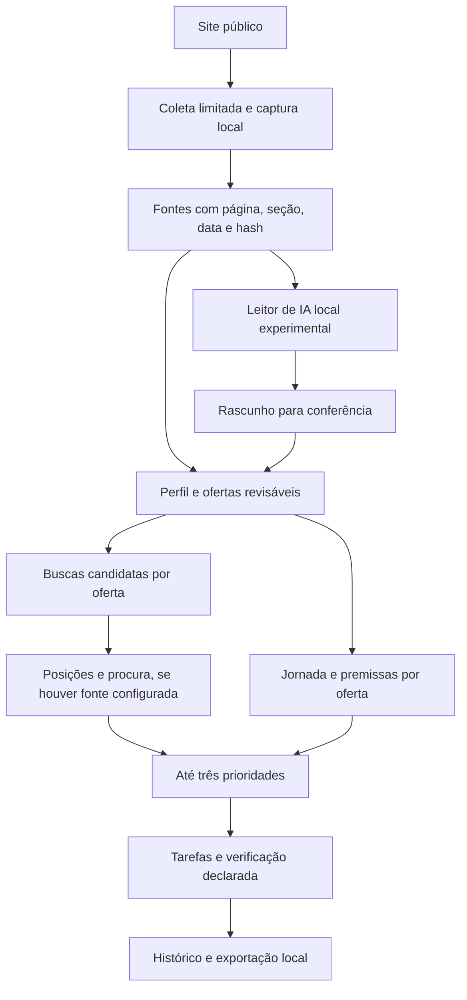

# Arquitetura local integrada

O domínio inicia a coleta. A organização confirma o negócio antes de usar as prioridades. O leitor de IA é opcional; sua saída continua como hipótese com fontes e nunca modifica o perfil automaticamente.

## Contratos dos módulos

| Módulo | Entrada e responsabilidade | Implementação |
| --- | --- | --- |
| Coleta e evidências | Páginas públicas dentro dos limites; preserva cobertura e falhas | `src/coleta.mjs`, `ia/negocio/fontes-v4.mjs`, `lib/entendimento-local.mjs` |
| Entendimento | Separa oferta, comprador, executor, beneficiário, pagador e condições; citações copiadas pelo programa | `ia/negocio/jornadas/` |
| Perfil revisável | Guarda correções e exige nova confirmação; uma correção não atualiza pesos | `src/modulos/perfil.mjs`, `jornadas.mjs`, `revisao-perfil.mjs` |
| Descoberta | Gera candidatos com origem; não mede procura nem posição | `src/modulos/palavras.mjs` |
| Medição | Mantém fonte, contexto, profundidade, prazo e cota; sem fonte permanece indisponível | `src/modulos/medicao.mjs`, `src/serpapi.mjs` |
| Demanda | Opt-in do operador; dados históricos e variantes agrupadas | `src/modulos/google-ads.mjs`, `demanda.mjs` |
| Economia | Origem, período e coorte; valores/faixas/contagens; custos separados | `src/modulos/premissas-economicas.mjs` |
| Prioridades | Liga ações à oferta e às evidências disponíveis, sem inventar lucro ou desperdício | `src/modulos/oportunidades.mjs`, `prioridades-local.mjs`, `prioridades-assistidas.mjs` |
| Execução | Estados, responsável, revisões e critério verificado; concluir não prova resultado positivo | `src/modulos/tarefas.mjs` |
| Coordenação | Revisão do projeto, consistência, persistência e jobs de IA assíncronos | `src/modulos/coordenador.mjs`, `lib/sqlite.mjs`, `server.mjs` |
| Entrega | Interface sem cadastro e plano exportável | `src/projeto.html`, `src/modulos/relatorio-cliente.mjs` |

O núcleo usa Node e SQLite. A inferência e o ajuste experimental de pesos usam o ambiente MLX local já instalado no Mac com Apple Silicon. A execução do produto não chama a API de uma IA remota. A curadoria técnica dos experimentos desta sessão foi feita por agentes Codex, sem se apresentar como avaliação humana ou confirmação das empresas.

## Evidência e significado

Uma citação real pode sustentar o nome de um público e ainda não provar que esse público contrata aquela oferta. Por isso, cada papel mostra sua própria evidência e contexto. Identificar uma faixa numérica também não confirma o vínculo com a modalidade ou o significado comercial.

Um cenário por contato qualificado depende das premissas informadas. Ele não é valor de palavra-chave, previsão de vendas ou orçamento recomendado. As premissas financeiras não entram no leitor de páginas públicas.

As regras e os pesos são avaliados separadamente. Testes de software, controles autorais, empresas reservadas e confirmação da empresa são evidências diferentes. Os experimentos conservam dados, código, configurações, respostas brutas, recusas, hashes e resultados anteriores. Nenhum candidato é promovido automaticamente.

Consulte [uso e retenção local](USO-LOCAL-INTEGRADO.md) e [treino e avaliação de jornadas](../ia/negocio/jornadas/README.md).
