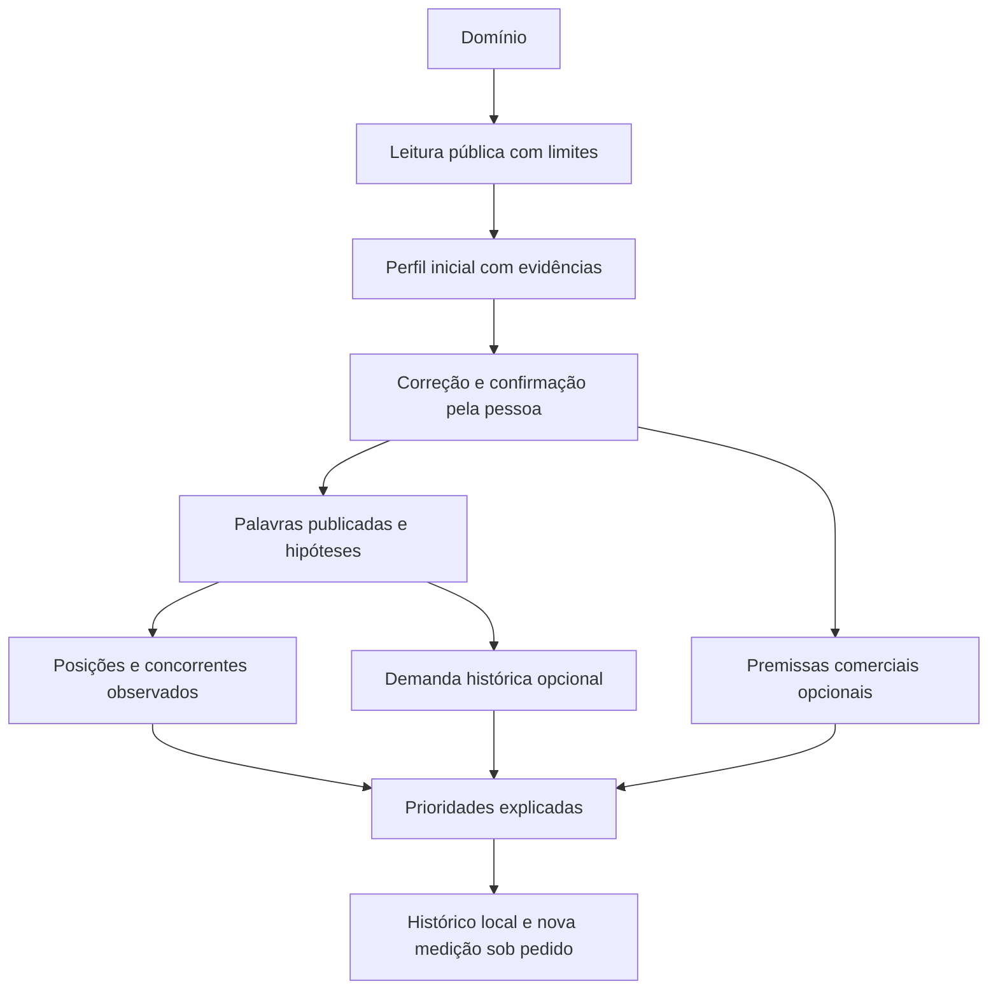

# Análise por módulos

Esta implementação local conecta entendimento revisável do negócio, descoberta,
medição, avaliação e acompanhamento. Cada módulo tem uma entrada definida,
saída versionada e testes próprios. O mesmo repositório permite mudar um módulo
e verificar imediatamente o efeito nos demais; não é necessário operar cinco
servidores ou instalar cinco modelos.

Abra `/projeto` no servidor iniciado com `npm start`. A página anterior continua
disponível em `/`. A nova experiência usa regras auditáveis: não declara que os
modelos experimentais de IA já estejam prontos para decisões de clientes.



## Módulos implementados

| Etapa | Arquivos em `src/modulos` | Responsabilidade |
| --- | --- | --- |
| Entender | `perfil.mjs`, `entendimento-negocio.mjs`, `contexto-publico.mjs`, `interacoes-publicas.mjs` | Propor um perfil com finalidade, públicos, atividades e relações declaradas; preservar fontes e aceitar correções sem transformá-las em observações. |
| Descobrir | `palavras.mjs` | Relacionar termos a ofertas, distinguir publicação de hipótese, aplicar exclusões e limitar o plano. |
| Medir | `medicao.mjs` | Entregar o plano ao coletor de posições existente, com fila própria e franquia compartilhada. |
| Avaliar | `demanda.mjs`, `oportunidades.mjs`, `plano-negocio.mjs` | Validar evidências e estimativas, propor conferências específicas, rascunhos, dependências e critérios de conclusão. |
| Acompanhar | `acompanhamento.mjs`, `revisao-perfil.mjs` | Reter até 24 eventos, registrar as correções declaradas e comparar observações compatíveis, sem atribuir causalidade. |
| Entregar | `relatorio-cliente.mjs` | Exportar um plano Markdown com cobertura, tarefas, fontes e critérios de conclusão, sem os campos financeiros estruturados. |
| Coordenar | `coordenador.mjs`, `repositorio.mjs` | Executar as etapas, persistir revisões e impedir sobrescrita concorrente. |

O coletor público, o parser de resultados e o diagnóstico de acessibilidade já
existentes são reutilizados. Não se duplicam mecanismos de cota ou validação.
O diagnóstico técnico lê até três páginas; a descoberta lê até doze. A cobertura
é exibida, inclusive quando uma leitura falha ou o site exige JavaScript.

## Contratos e decisões

Projetos e relatórios mantêm `versao: 1`; o entendimento interno do negócio está
em `perfil.entendimento.versao: 2`. Posições mantêm o contrato existente
`versao: 2`. Dados de uma etapa não são instruções para a seguinte: conteúdo do
site é tratado como texto. Não é executado como código ou prompt de ferramenta.

O perfil aceita até oito ofertas. A confirmação é explícita em cada gravação.
Correções são declarações do usuário; não viram fatos observados no site.
Renomear uma oferta muda sua identificação e retira a evidência que não a comprova.
Uma pessoa, artista ou tema citado não demonstra representação nem exclusividade.

`perfil.entendimento` registra o papel sugerido (`intermediacao`, `servicos`,
`produtos`, `misto` ou `indefinido`), sua natureza e as evidências. `perfil.perguntas`
aponta informações que faltam sobre comprador, área atendida e premissas
econômicas. A entrada editável `papel` permite contestar a hipótese, preservando
a natureza de declaração do usuário. Público e comissão não são deduzidos do domínio.

O entendimento separa finalidade comercial, social ou indefinida; propósito;
públicos como cliente, participante, beneficiário e apoiador; ofertas vendidas e
atividades de programa social, captação ou participação. As interpretações públicas
continuam hipóteses. Público mencionado não comprova quem paga, decide ou converte.
O formulário aceita finalidade e até oito atividades não comerciais, além das oito
ofertas. Uma atuação social pode ter uma loja explicitamente publicada, sem que a
doação vire venda. Cada oferta tem importância principal, complementar ou indefinida,
como hipótese ou declaração; ela organiza a investigação, não prevê retorno.

O contexto público guarda até 24 referências de identidade/ofertas e 64 detalhes
de conteúdo visível, no máximo 24 por página e 360 caracteres por detalhe. A seleção
distribui espaço entre URLs e guarda campo, seção, data, hash e indicação de recorte.
Esses limites não garantem leitura completa nem execução de JavaScript.

O contexto inclui uma lista separada de até 48 rótulos de campos, botões e links
públicos, até oito por página. Cada interação registra grupo, tipo, rótulo literal,
URL, campo de origem, data, hash, `htmlInicial: true` e `modo: nao_preenchido`.
Valores, campos ocultos e conteúdo preenchido não entram nessa lista. Uma
interface observada não comprova oferta, operador, funcionamento ou conversão.

`entendimento.relacoes` retém até seis relações propostas com texto e referências
literais: canal de comercialização, execução própria ou por terceiros,
formalização entre partes, conexão entre grupos ou parceria. Negação e objeto da declaração importam;
um botão de compra ou uma parceria isolada não demonstra intermediação.
`entendimento.territorios` separa até seis lugares explicitamente citados do
público humano. Esses lugares não preenchem as regiões comerciais do perfil.

A inferência considera também o propósito da fonte: conteúdo editorial,
recrutamento e atendimento não demonstram, por si, uma oferta à venda. Uma
declaração estruturada ou serviço contratado específico continua sujeito à
revisão do responsável. Termos negativos não herdam vínculo comercial.

Palavras publicadas carregam página, trecho e data. Sugestões além do conteúdo
só são geradas depois da confirmação e continuam marcadas como hipóteses.
Há até cem candidatos, sem preencher a lista artificialmente. Expressões que
ultrapassam o contrato do fornecedor são descartadas, nunca truncadas em outra busca.
As hipóteses respeitam o objeto da atividade: inscrição, compra, reserva ou
contratação, em vez de aplicar orçamento a todos os casos. Rótulos genéricos de
idioma e navegação ficam fora da fila, preservados na descoberta original. Uma
marca ou oferta exata declarada pelo usuário pode continuar na seleção.

O plano distingue tarefas de negócio, técnicas, publicação, dados e qualificação
em `eixo`. A lista `planoNegocio` é um recorte do plano geral. Uma decisão
específica pode coexistir com uma conferência técnica na mesma página. Quando
há base suficiente, `decisaoCliente` registra objeto, objetivo, escolha, percurso,
fatos com fontes, restrições, incertezas e resultado a conferir. Esse objeto é
uma hipótese de melhoria do uso e exige revisão; não prova defeito ou retorno.
Aliases com os mesmos fatos e o mesmo percurso podem compartilhar uma decisão,
mantendo nomes, escopos e fontes por oferta e até quatro páginas relacionadas.
Condições distintas, como duração ou requisitos de cursos, não são unidas apenas
porque duas tarefas usam o mesmo modelo de texto.

A seleção distribui espaço entre ofertas em cada faixa de prioridade, evitando
que uma só oferta ocupe todos os cem lugares. Pontuação terminal não impede
ligações literais, e nomes específicos têm preferência sobre nomes genéricos
contidos na mesma expressão. As regras não fazem associação livre por similaridade.

A fila de posições segue o plano do negócio. Buscas relacionadas do fornecedor
não entram automaticamente nessa fila, contornando exclusões ou gastando cota.
Uma alteração da seleção invalida a associação ao plano anterior. A data da
leitura do site não é substituída pela data de preparação de uma fila.

Posições são observações de Google Brasil, português, computador e recorte
nacional. Regiões do perfil ajudam a formular hipóteses, mas não mudam esse
recorte nesta versão. A fonte configurada é necessária. Ausência de fonte,
falha e captura vencida nunca viram posição zero. O servidor revalida capturas
ao abrir uma análise salva; após uma hora elas deixam de confirmar posição atual.

Cada oportunidade informa observação, motivo, ação, forma de verificar, dados
faltantes e evidências. Relação com oferta e intenção comercial vêm antes do
volume. A ordenação é uma regra de organização de testes, não uma previsão de lucro.
Sem custos, conversões e atribuição não há afirmação de desperdício ou ordem para
redistribuir verba. O sistema não modifica anúncios ou páginas.

As premissas econômicas são opcionais e específicas da oferta:

`cenário de contribuição por contato = contribuição por venda × taxa de fechamento`

A contribuição é a receita do próprio negócio após custos variáveis. Para uma
intermediadora, parte da comissão, e não do valor total do contrato do artista.
O cenário é anterior à aquisição e aos custos fixos. Não é receita prevista,
valor por clique, probabilidade de rankear ou resultado demonstrado para uma palavra.

`oportunidades.frentes` agrupa as buscas por oferta, com página a conferir,
próximo teste e dados faltantes. A página pode ser uma declaração do usuário ou
uma URL observada, com proveniências diferentes. A falta de URL provoca uma
conferência do inventário, sem ordenar a criação de uma página por palavra.
Zero explícito de demanda ou do cenário econômico orienta validação das
premissas; dado ausente continua desconhecido. Grupos de variantes mantêm
volume compartilhado e não produzem volume individual para cada termo.

`oportunidades.planoDeAcao` reúne achados técnicos pela página e verificação.
Testes de negócio preservam a oferta ou atividade, mesmo quando compartilham a URL.
Achados do diagnóstico atual da mesma URL podem orientar correções mesmo sem
fonte de posições. Onde não há defeito confirmado, o próximo passo é uma
conferência identificada como hipótese. Cada tarefa informa passos, evidências
e critério de conclusão, além de entregável, rascunho com origem de cada campo,
dependências e esforço editorial estimado. Os trechos publicados podem ajudar a
comparar modalidades, formatos e caminhos de atendimento; não demonstram sozinhos
que a página está errada. Uma atuação social confirmada pode produzir esse plano
sem cadastrar uma oferta comercial. Sem leitura suficiente, a orientação é conferir
o conteúdo visível antes de sugerir uma edição.
Contribuição negativa declarada é aceita e orienta revisão das premissas,
sem ser apresentada como prejuízo medido do negócio ou de uma palavra.

## API local

`POST /api/projeto`, JSON, mesma origem do servidor. O servidor aceita domínio
e campos do perfil, nunca capturas, posições, volume ou credenciais enviados
pela interface. A rota de perfis não está habilitada no worker público.

| Ação | Entrada adicional | Efeito |
| --- | --- | --- |
| `iniciar` | nenhuma | Lê o site e cria o rascunho; se já existir, abre o projeto salvo. |
| `consultar` / `historico` | nenhuma | Lê o estado e revalida a atualidade, sem consultar fontes. |
| `salvar_perfil` | `revisao`, `perfil` | Salva a revisão, regenera candidatos e invalida resultados associados ao perfil anterior. |
| `reler_site` | nenhuma | Atualiza a leitura sob pedido, preservando declarações confirmadas. Intervalo mínimo de um minuto. |
| `revisar_leitura` | `revisao` recomendada | Propõe uma interpretação com as regras atuais sobre a leitura salva, sem coletar novamente, alterar o perfil, consumir cota ou gravar histórico. |
| `medir` | nenhuma | Exige perfil confirmado; prepara ou avança um lote dentro da franquia existente. |
| `analisar` | nenhuma | Reavalia prioridades e, se configurada, consulta a fonte opcional de demanda. |
| `experimentar_ia` | nenhuma | Executa o piloto local instalado sobre até três contextos públicos, com recusas e origem da decisão preservadas. |
| `experimentar_ia_candidata` | nenhuma | Compara o adaptador experimental instalado, preservando a resposta anterior em campo separado. |
| `exportar_plano` | `revisao` recomendada | Recompõe a análise salva e devolve Markdown, sem novas consultas, alterações de revisão ou uso de cota. |
| `excluir` | `revisao` | Remove perfil, histórico e filas modulares do domínio. Não renova cotas. |

`revisao` também pode acompanhar outras ações para detectar uma tela desatualizada.
Erros `409` indicam revisão divergente, projeto ocupado ou etapa que precisa de
confirmação; `404`, ausência de projeto; `400`, contrato inválido. O formulário
limita requisições de perfil a 64 KiB; campos e quantidades continuam limitados.
Não existe polling no fluxo modular.

A ação `revisar_leitura` retorna `propostaDaLeitura` para comparação. A fonte
mantém sua data original; uma nova interpretação não é uma nova captura. A
interface apresenta as sugestões separadas do formulário e exige que o usuário
edite os campos que deseja corrigir. Alterações ainda não salvas bloqueiam essa
comparação para preservar o trabalho em edição.

A resposta inclui `capacidades`: configuração das fontes e instalação do piloto
local, sem credenciais. Configuração não comprova disponibilidade do fornecedor.
Abrir um projeto salvo regenera seus candidatos com as regras atuais. Uma
seleção diferente invalida a associação ao plano anterior antes de usar cota,
preservando o histórico; a consulta de leitura não cria uma revisão gravada.

O SQLite aplica `0002_projetos_modulares.sql` sem alterar migrações existentes.
Uma atualização grava estado e histórico por revisão atômica. Arquivos de dados,
credenciais e relatórios privados ficam ignorados pelo Git. A exportação JSON é
local e inclui declarações e premissas: revise antes de compartilhar.

Ao salvar o perfil, `historico[].revisaoPerfil` registra o que mudou nos campos,
ofertas, importância, finalidade, atividades e confirmação. Premissas financeiras geram somente uma indicação de
alteração, sem copiar seus valores para o histórico. Registros anteriores à
implementação não recebem diferenças reconstruídas. Correções continuam sendo
declarações do usuário, sem treinamento automático.

O botão **Baixar plano de trabalho** exporta Markdown com até 64 tarefas únicas
e suas evidências, distinguindo trecho publicado de achado derivado do HTML, com
data, URL, campo e hash quando disponíveis. Preserva critérios da ordem de trabalho,
rascunhos e dependências. Contribuição e taxa de fechamento ficam fora desse arquivo;
preços ou outros valores em textos livres podem permanecer. **Exportar dados
completos** mantém o JSON local com as premissas e respostas experimentais.

## Fontes externas opcionais

A medição reutiliza a integração SerpApi e seu bloqueio de planos pagos. A
franquia local não cria créditos no fornecedor: consulte [ativação](ATIVAR-POSICOES.md).
Não há simulação de posições quando a chave não existe e não há coleta automática
do Google por navegador nesta implementação. A [política do Google](https://developers.google.com/search/docs/essentials/spam-policies#machine-generated-traffic)
inclui consultas automatizadas de acompanhamento de posições sem permissão.

O contrato de demanda aceita `fonte`, `coletadoEm`, `pais`, `idioma`, `periodoInicio`,
`periodoFim` e `itens[{termo,buscasMensais}]`. O adaptador roda no servidor e é
opcional. Dados ausentes, futuros, repetidos ou vencidos são recusados; zero
explícito é preservado. Estimativas de variações não são somadas.

O Google Ads oferece [ideias a partir de palavras e URLs](https://developers.google.com/google-ads/api/docs/keyword-planning/generate-keyword-ideas)
e métricas históricas. Esses métodos não fornecem posição orgânica, nem acesso
a gastos ou vendas do cliente. A execução depende do acesso habilitado da conta
técnica. O programa não cria contas, não contrata planos e não ativa campanhas.

O adaptador `google-ads.mjs` implementa a consulta de métricas históricas dos
termos selecionados. Ative somente se já houver acesso aprovado, preenchendo
no `.env` local `GOOGLE_ADS_DEMANDA=1`, `GOOGLE_ADS_CUSTOMER_ID`,
`GOOGLE_ADS_DEVELOPER_TOKEN` e `GOOGLE_ADS_ACCESS_TOKEN`. O identificador da conta
gerenciadora `GOOGLE_ADS_LOGIN_CUSTOMER_ID` é opcional. A versão REST padrão é
`v26`, configurável por `GOOGLE_ADS_API_VERSION`. Esses campos nunca vão ao navegador.

O token de acesso tem validade limitada; esta versão não implementa o fluxo OAuth
de obtenção/renovação. Expiração ou acesso recusado gera indisponibilidade, não
uma estimativa substituta. A consulta só acontece ao pedir análise de um perfil
confirmado. Não exige conta Google de cada cliente para o restante da aplicação.

A requisição pede os doze meses completos anteriores, Brasil e português, na
rede Google Search. A resposta precisa confirmar os meses; períodos incompletos
não são apresentados como cobertura completa. Grupos de variantes permanecem
separados, com seu volume compartilhado, sem atribuí-lo a cada palavra. Esse
volume agrega dispositivos e não é demanda exclusiva de computador. Consulte
[métricas históricas](https://developers.google.com/google-ads/api/docs/keyword-planning/generate-historical-metrics)
e [códigos oficiais](https://developers.google.com/google-ads/api/data/codes-formats).

A implementação foi testada com respostas simuladas. Sem credenciais e acesso
aprovado, não há validação de ponta a ponta com a conta real do Google Ads.

## Evolução dos agentes e treinamento

Cada módulo pode receber posteriormente um modelo local, preservando seu
contrato e as validações. Primeiro compare a proposta do modelo às regras desta
versão. O modelo pode propor entendimento e hipóteses; posições, volumes e
cálculos continuam dependendo de fontes e validação externa ao modelo.

Correções do perfil não alteram pesos. Para treinar, será necessário separar
exemplos autorizados, revisão humana e conjunto de teste reservado por empresa
e período. Avalie especialmente ofertas inventadas, vínculos comerciais errados,
posições sem evidência, interpretação indevida de volume e recomendações de verba
sem atribuição. Aprovação em testes de código não demonstra ganho comercial.

O piloto de IA anterior continua experimental, documentado em
[TREINAR-IA.md](TREINAR-IA.md). Esta entrega implementa os módulos e a integração;
não promove um novo checkpoint a modelo confiável para clientes.

A interface modular oferece o piloto instalado sob uma ação explícita. Ele
recebe uma projeção das evidências públicas validadas e um contexto revisável de
papel, finalidade, atividade relacionada e público declarado. Não recebe decisões
do motor, hipóteses de novas palavras, comissão ou premissas financeiras. A análise
comercial continua no motor modular. Uma escolha conhecida sem evidência
aplicável é recusada; a tela distingue escolha do modelo e encaminhamento por
regra. Respostas com evidências alteradas ou vencidas são marcadas históricas.
Esse piloto não compreende automaticamente todo o perfil comercial.

`selecao-contextos.mjs` escolhe no máximo três contextos ligados a oferta ou atividade
publicada, ou a uma diretiva de publicação observada. Navegação e slogans sem vínculo
não preenchem as vagas. Sem contexto elegível, não executa o modelo: registra
`sem_contexto` e orienta a revisão da leitura. Isso não elimina as tarefas do motor.
Projetos legados preservam as declarações salvas; atualizar o código não significa
que o responsável confirmou uma nova interpretação do negócio.

O [guia de treino e avaliação](TREINAR-IA.md) descreve como comparar um ajuste
local com o modelo-base antes de escolher os pesos.

## Verificação e contribuição no GitHub

```sh
npm test
npm run check
node --test test/modulos-*.test.mjs test/projeto-portal.test.mjs
```

Os testes de integração usam SQLite temporário e fonte simulada identificada
como fixture, sem rede ou cobrança. Exercitam revisão concorrente, reinicialização,
mudança do plano, ausência de fonte, captura expirada, leitura antiga, controle de
origem, exclusão e conservação de cotas. Os testes de interface executam o script
com DOM controlado, incluindo escape de conteúdo e percentuais.

Uma contribuição pode alterar apenas um módulo e seus testes. Mudanças de
contrato devem incluir o coordenador e a compatibilidade. Separar repositórios
ou publicar pacotes é uma opção posterior, quando houver usuários independentes
de cada módulo; não é requisito para rodar localmente esta versão.
